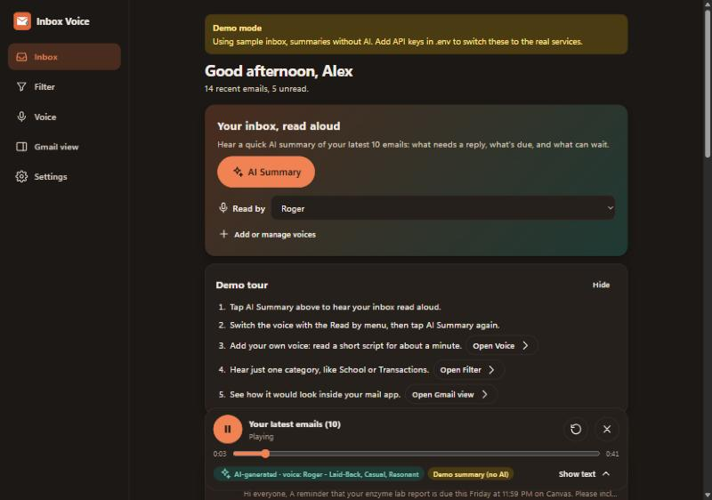
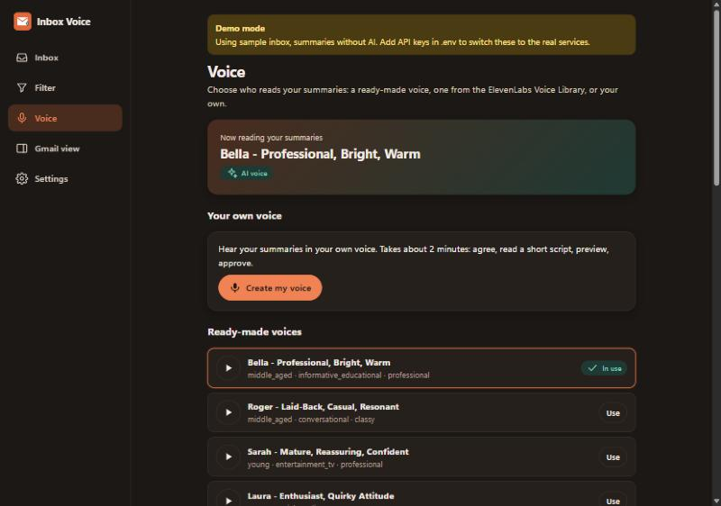
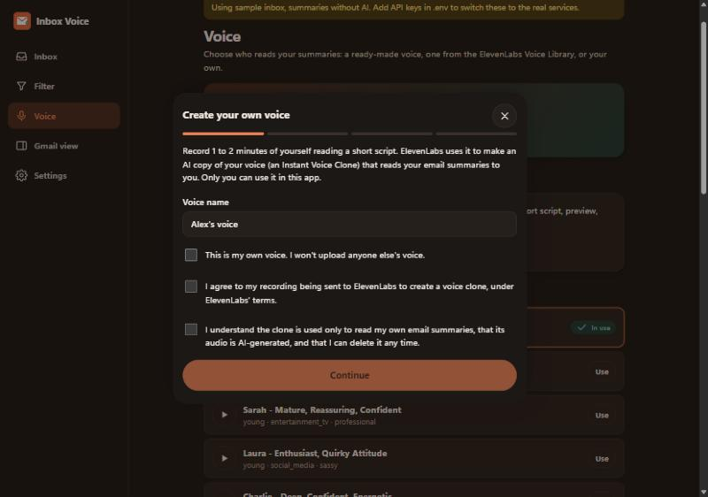
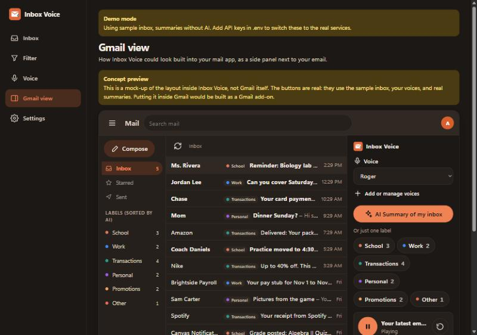

# Inbox Voice

Hear your Gmail. Sign in with Google, tap **AI Summary**, and an AI voice reads a short briefing of your latest emails: what needs a reply, what's due, and what can wait. The **Filter** tab uses AI to sort mail into School, Work, Transactions, Personal, Promotions (and any categories you add) so you can hear a summary of just one category. The **Voice** tab lets you pick an ElevenLabs voice, add one from the ElevenLabs Voice Library, or record your own voice and have summaries read in it.

- **Gmail**: read-only (`gmail.readonly`). The app can't send, delete or change mail.
- **Summaries and sorting**: Anthropic Claude **or** Google Gemini, each through its official SDK. Set whichever key you have.
- **Speech and voice cloning**: ElevenLabs Text to Speech and Instant Voice Cloning.
- **Stack**: TypeScript everywhere. Node 22.18+ runs the `.ts` server directly. Express 5 and SQLite (`node:sqlite`) on the server; React 19 and Vite on the front end; mobile-first and installable to the home screen.

## Screenshots

| Inbox with the **Read by** voice menu | Voice tab (add and choose voices) |
|---|---|
|  |  |
| **Create your own voice** | **Gmail view** (concept: Inbox Voice as a side panel in your mail app) |
|  |  |

Presenting it? See **[DEMO.md](DEMO.md)** for a 4-minute demo script.

---

## Status: what's verified and what isn't

| Area | Verified how | Live service tested? |
|---|---|---|
| Full app flow in a browser (sign-in → consent → inbox → AI Summary → playback; Filter → category summary; own-voice wizard → preview → approve; settings) | Clicked through in a real browser in **demo mode**, desktop and phone-sized | No (demo stand-ins) |
| Server API, authorization, caching, dedupe, rate limits, deletion | 92 automated tests (`npm test`) against the real server, database and files, with **mock** providers | No |
| Gmail / Google OAuth requests | Unit tests with mocked HTTP that check URLs, params and error mapping against Google's docs | **No**. Needs your Google Cloud project |
| Anthropic requests | Unit tests through the real SDK with a mocked `fetch` | **No**. Needs `ANTHROPIC_API_KEY` |
| Gemini requests | Unit tests through the real `@google/genai` SDK with a mocked `fetch` | **No**. Needs `GEMINI_API_KEY` |
| ElevenLabs speech | Mocked unit tests, **plus one live run on 2026-11-14**: a free-plan key returned 21 ready-made voices and a real MP3 summary | **Yes** (ready-made voices only) |
| ElevenLabs cloning | Mocked unit tests. The live account check showed the free plan can't clone | **No**. Needs a paid plan |

**Live so far:** ElevenLabs speech with a ready-made voice. **Not yet live:** Gmail, Anthropic, Gemini and ElevenLabs cloning. Passing mocked tests show the app follows the documented request formats; they don't prove the live services accept them. See [Untested or blocked](#untested-or-blocked) for the full list.

---

## Quick start (demo mode, no keys needed)

```bash
npm install
npm run dev
```

Open http://localhost:3000 and click **Try the demo inbox**. Demo mode uses a sample inbox, a non-AI summary, and placeholder tones instead of a voice. The app shows a banner naming every part that's a demo. Add keys (below) and each part switches to the real service.

Other scripts:

```bash
npm test
```

```bash
npm run typecheck
```

```bash
npm run build
```

```bash
npm start
```

`npm start` serves the built app from `web/dist`; run `npm run build` first.

---

## Account setup for the real services

Copy `.env.example` to `.env` and fill it in. Keys stay on the server and are never sent to the browser.

```bash
cp .env.example .env
```

Generate a `SESSION_SECRET`:

```bash
node -e "console.log(require('crypto').randomBytes(32).toString('base64url'))"
```

### 1. Google (Gmail)

1. Go to the [Google Cloud console](https://console.cloud.google.com/) and create a project.
2. **APIs & Services → Library → Gmail API → Enable**.
3. **OAuth consent screen**: choose **External**, add an app name and support email, then add the scopes `openid`, `email`, `profile` and `https://www.googleapis.com/auth/gmail.readonly`.
4. Under **Test users**, add every Gmail address that will sign in (Testing mode allows up to 100).
5. **Credentials → Create credentials → OAuth client ID → Web application**. Add the redirect URI `http://localhost:3000/auth/google/callback`, plus the HTTPS URL you use on a phone (see below).
6. Put the client ID and secret in `GOOGLE_CLIENT_ID` and `GOOGLE_CLIENT_SECRET`.

What to expect, from Google's docs:

- `gmail.readonly` is a **restricted** scope. In Testing mode, only listed test users can sign in. They see a "Google hasn't verified this app" screen, and their authorization **expires after 7 days**, so the app asks them to sign in again.
- Publishing to the public requires Google's restricted-scope verification **and** a third-party security assessment, because this server stores and sends restricted data.
- Gmail quota is 6,000 units per user per minute. One inbox load costs about 5 + 20 × 30 = 605 units; each email in a summary costs 60.

### 2. Anthropic (summaries and Filter)

- Create a key at the [Anthropic Console](https://console.anthropic.com/), add billing, and set `ANTHROPIC_API_KEY`.
- Default model: `claude-opus-5-5`. Override it with `ANTHROPIC_MODEL`. Sorting uses `effort: low`; summaries use `effort: medium`.
- **Refusal fallback is on** (`ANTHROPIC_REFUSAL_FALLBACK=default`). If the model declines a request, the API retries it once on a fallback model inside the same call. Set it to `off` to disable this.

### 2b. Or Google Gemini (instead of Anthropic)

- Go to [Google AI Studio](https://aistudio.google.com/apikey), sign in, and click **Create API key**. New users get a default project and key.
- Put it in `GEMINI_API_KEY`. If you also have an Anthropic key, set `AI_PROVIDER=gemini` to choose Gemini.
- Default model: `gemini-3.5-flash-lite`. In a live comparison on 2026-11-14 it wrote an equally good inbox summary in about 1 second, versus about 12 seconds for `gemini-4-hydrogen`. Override it with `GEMINI_MODEL`.
- **Backup model**: if the main model is busy or slow (429/503/504), the app retries once with `gemini-4-hydrogen` (`GEMINI_FALLBACK_MODEL`; `off` disables it). Requests time out after 25 seconds instead of the SDK's default of five attempts with waits of up to a minute.
- **Free tier and privacy**: Google's terms say free-tier prompts and responses may be used to improve Google's products and read by human reviewers. That stops when the key's Google Cloud project has an active billing account (paid tier). Hackathon credits, such as the MLH/Google offers, are applied through a billing account. The app's privacy screen says this whenever Gemini is in use.
- **Free-tier limits**: limits are per minute and per day. When they're hit, the app shows "Gemini's usage limit was reached… try again".
- **Region rule**: Google's terms allow only the paid tier for apps offered to people in the EEA, Switzerland or the UK.
- **Switching AI provider** (Claude ↔ Gemini) asks everyone to agree to the privacy screen again, because it names the company that reads the email.

### 3. ElevenLabs (voice)

- Create a key in your ElevenLabs account settings and set `ELEVENLABS_API_KEY`. If you restrict the key's permissions, allow text to speech, voices, and reading the user's subscription.
- Default model: `eleven_v4`, ElevenLabs' current flagship and most lifelike, expressive model (10,000 characters per request; tested live 2026-11-14). Override it with `ELEVENLABS_MODEL_ID`, for example `eleven_multilingual_v2` (steadier) or `eleven_flash_v2_5` (cheapest and fastest).
- **Plans**: I couldn't confirm from ElevenLabs' docs which plan first includes Instant Voice Cloning. The app checks `can_use_instant_voice_cloning` from `GET /v1/user/subscription` before uploading and shows a clear message if cloning isn't available. Ready-made voices work without cloning.
- **One ElevenLabs account serves everyone.** Each person's clone lives in your account and uses a voice slot. The app never lists or allows other people's clones, and deleting a voice in the app deletes it at ElevenLabs.

---

## Using it on your phone

Two browser rules decide how this works:

1. **Google sign-in** only redirects to `http://localhost…` or an **HTTPS address on a public domain**. Raw IPs like `192.168.1.20` aren't allowed.
2. **Microphone recording** only works on HTTPS pages or localhost.

So opening `http://192.168.x.x:3000` on your phone won't work for Google sign-in or recording. Pick one of these instead:

- **Tunnel (quickest)**: run a tunnel such as Cloudflare Tunnel or ngrok to `localhost:3000`, which gives you an `https://…` address.
  1. Set `PUBLIC_URL` to that address.
  2. Add `PUBLIC_URL/auth/google/callback` as a redirect URI in Google Cloud.
  3. Restart the app and open the address on your phone.
  4. A free tunnel URL changes each time it starts, so update both settings when it does.
- **Deploy (steadier)**: any Node host with HTTPS and a persistent disk for `data/` (for example Render, Railway or Fly.io). Set the same environment variables there.
- **Demo only**: the demo inbox doesn't need Google. Over plain Wi-Fi, though, recording still needs HTTPS. Uploading an audio file works.

Once it's open on the phone, use **Share → Add to Home Screen** (iPhone) or **Install app** (Android) for a full-screen app icon.

---

## Demo walkthrough (about 3 minutes)

1. **Sign in**: Sign in with Google, or click **Try the demo inbox**.
2. **Inbox**: tap **AI Summary**. On first use the app explains exactly what's sent to Anthropic and ElevenLabs and asks you to agree. The player then shows "Reading your emails…" → "Turning the summary into speech…" → plays. It's labeled **AI-generated** with the voice name. **Show text** shows the transcript.
3. **Tap the same button again**: it replays instantly from the saved copy. The player says "saved copy, no new charge".
4. **Open an email** → **AI Summary of this email**.
5. **Filter**: the inbox is sorted into categories with counts. Tap **School** → **AI Summary of School**. Under **Edit categories**, add "Sports: practices and games" and watch the inbox re-sort.
6. **Voice**:
   - Pick a ready-made voice, or search the Voice Library and **Add** one.
   - Or **Create my voice**: tick the three consent boxes, read the on-screen script (1 to 2 minutes; a timer and level meter help) or upload a file, then **Create my voice** → **Play sample** → **Use this voice**.
   - Your summaries are now read in your voice. **Delete** removes the clone at ElevenLabs and every saved audio file made with it.
7. **Settings**:
   - Listening options: summary length, speaking speed, how many emails, auto-play, auto-sort.
   - **Turn off** AI features, which deletes saved summaries, audio and sorting.
   - Clear saved content.
   - **Delete account and data**, which revokes Google access, deletes your clone at ElevenLabs, and removes all files and rows.

---

## How it works

```
Browser (React)  ──fetch + session cookie──>  Express server  ──>  Gmail API (read-only)
                                              │  SQLite + private files   ──>  Anthropic (summaries, sorting)
                                              └───────────────────────────>  ElevenLabs (speech, clones)
```

- `server/providers/`: one file per outside service (`google.ts`, `anthropic.ts`, `elevenlabs.ts`) plus `demo.ts` stand-ins. Each sits behind an interface in `types.ts`, so tests swap in mocks.
- `server/services/`: inbox sorting, summaries, voices/audio, account deletion.
- `server/app.ts`: routes, sessions, CSRF check, validation, error responses.
- `web/src/`: React app. `state.tsx` holds app data and the single audio player.

### Privacy and safety decisions

- **Server-side authorization on everything.** Summaries, audio, voices, categories and recordings are looked up by owner. Another person's item returns the same 404 as a missing one.
- **Voices**:
  - A summary can only use an ElevenLabs ready-made voice (`category: premade`), a library voice the person added, or their own **approved** clone.
  - Raw provider voice IDs from the browser are rejected.
  - Previews of an unapproved clone only ever say one fixed sentence, so a clone can't be made to say arbitrary text.
- **Consent**:
  - AI processing of email needs explicit, versioned consent.
  - Cloning needs three separate confirmations, including "this is my own voice".
  - Revoking AI consent deletes everything the AI produced.
- **What's stored**:
  - Email text is never saved.
  - Only message-ID → category pairs, the summaries, and the audio are kept, privately and for 72 hours by default (`CACHE_TTL_HOURS`), then deleted automatically.
  - Audio is served with `Cache-Control: private, no-store` and never as a public file.
- **Recordings**: uploads stay in memory and are discarded after cloning, unless the person ticks "Keep my recording". They can delete a kept recording later.
- **Tokens**: Google tokens are encrypted at rest (AES-256-GCM). Sessions are random tokens stored as hashes, in HttpOnly SameSite=Lax cookies.
- **Prompt injection**: email content is wrapped and labeled as untrusted. The AI is told never to follow instructions inside emails, and its output is only spoken text, with no actions.
- **No duplicate charges**:
  - Identical summary and speech requests are cached.
  - Simultaneous duplicates (double taps) share one provider call.
  - Rate limits apply only to new paid work, never to replays.
- **Limits**:

  | What | Limit |
  |---|---|
  | Emails per summary | 15 |
  | Email text sent to the AI, per email | 6,000 characters (longer emails are cut, and the summary says so) |
  | Spoken text per request | 2,500 characters |
  | Summaries | 30 per hour |
  | New audio | 40 per hour |
  | Sorting runs | 40 per hour |
  | Voice clones | 5 per day |
  | Voice uploads | 10 MB per file, 5 files |
  | Categories | 12 |

- **Honest labels**: every summary and audio file is labeled AI-generated. Demo output is labeled as demo.

---

## Untested or blocked

1. **No live Gmail, Anthropic or ElevenLabs call has been made.** Each needs your accounts and keys. First live run to try:
   1. Sign in with a test-user Gmail account.
   2. Tap AI Summary.
   3. Create a clone with a 1 to 2 minute recording.
2. **ElevenLabs Voice Library** (`GET /v1/shared-voices`, `POST /v1/voices/add/{public_user_id}/{voice_id}`): ElevenLabs' docs pages for these returned errors when I tried to read them. The add endpoint is confirmed indirectly by the Instant Voice Clone docs; the search endpoint's parameters come from prior knowledge. Using library voices through the API may need a paid plan.
3. **ElevenLabs ready-made voice listing** uses `GET /v2/voices?category=premade`. If your account returns no premade voices that way, set `ELEVENLABS_DEFAULT_VOICE_ID`.
4. **Browser recordings are uploaded as-is** (WebM/Opus on Chrome and Android, MP4/AAC on Safari). ElevenLabs recommends MP3 and accepts "a range of file types", but I haven't confirmed WebM or MP4 against the live API. If it rejects them, the app shows "ElevenLabs couldn't use this recording", and uploading an MP3 is the workaround.
5. **Plan requirements**: which ElevenLabs tier first includes Instant Voice Cloning wasn't stated on the pages I could read. The app checks at runtime instead of assuming.
6. **Anthropic refusal fallback combined with structured outputs** for sorting hasn't been tried live. If the API rejects the combination, set `ANTHROPIC_REFUSAL_FALLBACK=off`.
7. **Real-microphone recording** wasn't exercised; the test browser has no microphone. The upload path and every later step were exercised in the browser.
8. **Scale**: the rate limiter and caches are in memory, for a single server process. SQLite and local files assume one machine with a persistent disk.
9. **Google production use** needs restricted-scope verification and a security assessment, as described above. Until then it's limited to 100 test users with weekly re-sign-in.

## Platform notes

- **A button inside Gmail itself** would need a Gmail add-on (Google Apps Script), which runs in Gmail's side panel and gets the open message through add-on scopes. Google classifies `gmail.addons.current.message.readonly` as *sensitive*, not *restricted*, which may make verification easier. This prototype is a separate web app instead.
- **Text messages, iMessage and WhatsApp**: this app only reads Gmail through Google's official API. There's no supported way for a third-party app to read iMessage, and Android only lets the default SMS app read texts.
- **Cars**: you can listen over Bluetooth like any audio. Where the browser supports the Media Session API, lock-screen controls show the summary title; this hasn't been tested in a car. This is **not** a CarPlay or Android Auto app. Native CarPlay would need an iOS app with an Apple CarPlay entitlement, which this project doesn't attempt.

## Docs checked (2026-11-14)

- ElevenLabs:
  - [Create Instant Voice Clone](https://elevenlabs.io/docs/api-reference/voices/ivc/create)
  - [Text to Speech](https://elevenlabs.io/docs/api-reference/text-to-speech/convert)
  - [Models](https://elevenlabs.io/docs/models)
  - [Subscription](https://elevenlabs.io/docs/api-reference/user/subscription/get)
  - [Voices v2](https://elevenlabs.io/docs/api-reference/voices/search)
  - [Instant Voice Cloning guide](https://elevenlabs.io/docs/product-guides/voices/voice-cloning/instant-voice-cloning)
  - [API errors 400/401](https://elevenlabs.io/docs/help-center/technical/api-error-code-400-or-401)
- Google:
  - [OAuth 2.0 for web server apps](https://developers.google.com/identity/protocols/oauth2/web-server)
  - [Gmail API scopes](https://developers.google.com/workspace/gmail/api/auth/scopes)
  - [Gmail quota](https://developers.google.com/workspace/gmail/api/reference/quota)
- Anthropic: the official TypeScript SDK (`@anthropic-ai/sdk` 1.8) and its Messages API.
- Google Gemini (ai.google.dev redirects to aistudio.google.com/docs):
  - [API keys](https://aistudio.google.com/docs/api-key)
  - [Models](https://aistudio.google.com/docs/models)
  - [Structured output](https://aistudio.google.com/docs/structured-output)
  - [Pricing and data use](https://aistudio.google.com/docs/pricing)
  - [Terms](https://aistudio.google.com/docs/terms)
  - [Errors](https://aistudio.google.com/docs/api-errors)
  - SDK: `@google/genai` 3.3, using `models.generateContent`. The newer Interactions API in the docs isn't used yet.
